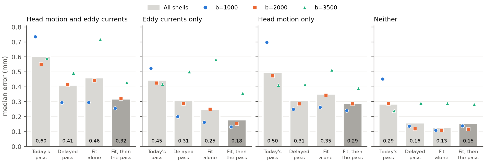

.. include:: ../links.rst

One field model before the eddy-current pass
============================================
:class:`~nifreeze.registration.eddy_field.EddyFieldFit`
(`#740 <https://github.com/nipreps/nifreeze/issues/740>`__,
`#741 <https://github.com/nipreps/nifreeze/pull/741>`__) fits one model of the
eddy-current fields of all the volumes: a matrix ``C`` and an exponent ``p`` of the
b-value, shared by every volume, give each volume's field from its b-vector and b-value,
``s_v = (b_v / b_ref)^p C g_v``.
Test 7 on `#735 <https://github.com/nipreps/nifreeze/issues/735>`__ asks whether running
the fit before the 9-parameter eddy-current pass lowers the pass's error
(`working hypothesis <https://github.com/nipreps/nifreeze/issues/735#issuecomment-7115624306>`__,
`results <https://github.com/nipreps/nifreeze/issues/735#issuecomment-7124391015>`__).

It does.
On the copy with head motion and eddy currents, the fit, then targets retrained on the
data it corrected, then the 9-parameter pass, with the shared field removed
(:func:`~nifreeze.registration.utils.remove_shared_field`,
`#738 <https://github.com/nipreps/nifreeze/issues/738>`__), has a median error of
0.32 mm.
The pass that Test 5 (:doc:`eddy-pass-rounds`) carried forward has 0.41 mm, and today's
pass 0.60 mm.
The gain comes from the targets: where the pass starts changes nothing.

What was compared
-----------------
The data are Test 4's four noisy copies of Sherbrooke (:doc:`eddy-pass-parts`): head
motion and eddy currents, eddy currents only, head motion only, and neither.
On each copy:

Today's pass
    Elastix, 12 parameters, the instant update (read from Test 4).
Delayed pass
    The 9-parameter ITK pass, every target trained on the data that the head-motion step
    corrected (read from Test 4); and the same with the shared field removed, Test 5's
    pass.
Fit alone
    :class:`~nifreeze.registration.eddy_field.EddyFieldFit` with the delayed pass's
    targets, from the head-motion step's estimates.
    It keeps their rotations and fits each volume's shift along phase encoding.
Fit, then the pass
    Targets retrained on the copy realigned by the fit's head motion and fields, then the
    9-parameter pass, each volume starting from the fit's estimate; as it is, and with
    the shared field removed.
The pass from the fit
    The 9-parameter pass with the delayed pass's targets, each volume starting from the
    fit's estimate: what the start alone changes.

The error is Test 4's: the whole mapping against the truth, in the frame of the
method's targets (mean displacement within the brain, mm).
Medians are on the 64 confirmation volumes; differences are paired by volume, stratified
by shell, with 95% intervals (10,000 resamples).

Results
-------

   Each method's median error on each copy: the bar over all shells, the marks for each
   shell, on the confirmation volumes.
   Lower is better.
   Both passes have the shared field removed.

* **On the copy with head motion and eddy currents,** the fit then the pass, with the
  shared field removed, is 0.068 mm better than the delayed pass with it removed
  ([−0.107, −0.056]), at every shell (b=1000 −0.026, b=2000 −0.097, b=3500 −0.138 mm),
  and 0.265 mm better than today's pass.
  The field's error falls from 0.278 to 0.107 mm.
* **On the copy with eddy currents only,** the same comparison gives −0.093 mm
  ([−0.133, −0.064]): 0.179 against 0.311 mm.
* **The gain is in the targets, not the start.**
  Started from the fit's estimates with the delayed pass's targets, the pass ends where
  it ends from the head-motion step (median difference below 0.001 mm on every copy).
* **Without eddy currents,** the fit then the pass ties the delayed pass (−0.005 and
  −0.001 mm).
  Without the removal, the pass puts back about 0.2 mm of field on those copies, where the
  fit alone leaves 0.016 mm: it is the shared stretch that Test 5 found, and the removal
  takes the field's error back to 0.05 mm.
* **Cost,** on 6 CPUs for 192 volumes: the fit takes 151 to 167 s, and retraining the
  targets 75 to 97 s.
  For scale, the 9-parameter pass takes 86 to 88 s.
* **The fitted exponent is 0.864 and 0.897** on the copies with eddy currents.
  The phantom's is 1, and with the true head motion and noise-free targets the fit gave
  0.993.
  So the fit alone falls short at b=3500 (0.717 mm on the copy with both, against 0.492 mm
  for the delayed pass with the shared field removed); the pass after the fit recovers
  that (0.429 mm).

.. csv-table:: Each method's medians on the confirmation volumes: the error, overall and
   by shell, and the field's error (mm).
   :file: ../_static/registration/eddy-field-start/eddy-field-start-sherbrooke-methods.csv
   :header-rows: 1
   :widths: auto

.. csv-table:: Paired differences, candidate minus reference: the median with its 95%
   interval, and each shell's median (mm). "Removed" means the shared field is removed.
   :file: ../_static/registration/eddy-field-start/eddy-field-start-sherbrooke-differences.csv
   :header-rows: 1
   :widths: auto

.. csv-table:: The fits: the exponent, ``C`` row by row, the evaluations of the cost and
   how each of the two stages ended, and the time.
   :file: ../_static/registration/eddy-field-start/eddy-field-start-sherbrooke-fits.csv
   :header-rows: 1
   :widths: auto

Without eddy currents, every entry of ``C`` is below 0.0006, so the exponent there means
nothing.

As registered
-------------
The working hypothesis compared every method against the delayed pass without the
removal.
By those comparisons, the start does not count; the fit's fields are closer to the truth
on the copies with eddy currents (−0.076 and −0.093 mm) and add none where there are none;
and the fit then the pass beats the delayed pass on the copy with both (0.369 against
0.423 mm, −0.068 [−0.094, −0.044]).
So the fit, then the pass, goes to HCP-YA, as the working hypothesis set out.
Removing the shared field from both passes was decided after the results (*post hoc*),
because Test 5 had made it part of the pass.
The registered decision is in
:download:`eddy-field-start-sherbrooke-decision.json <../_static/registration/eddy-field-start/eddy-field-start-sherbrooke-decision.json>`.

Checks
------
* Test 4's delayed pass, run again on the copy with both, matches Test 4's bit for bit,
  so the targets are the same.
* The fit keeps the head-motion step's rotations (to 1e-15) and its motion across phase
  encoding (to 2e-14).
* Every stage of every fit converged.
* The delayed pass with the shared field removed matches Test 5's exactly.

Limits
------
* One protocol, Sherbrooke; HCP-YA is next.
* The phantom's fields are linear in the b-vector and in the b-value (``p`` = 1), as the
  model is; real eddy currents need not be.
* The phantom's field has no shift along phase encoding of its own; real eddy currents
  can.

Reproducing
-----------
The run was made outside the phantom dataset, without a ``datalad run`` record, with the
dataset at commit 826e611 at the start and the end, itk-elastix 0.25.4, and
oesteban/nifreeze@c0a713ce4 (clean), on CPUs 0-5, in 49 min.
It reads Test 4's results (the head-motion step, its targets, the delayed pass and today's
pass).
The removal of the shared field was scored afterwards, at oesteban/nifreeze@e6772efc8
(clean), from the stored estimates.
From the repository's root::

    OMP_NUM_THREADS=6 uv run tools/registration/eddy_field_start.py --dataset <dataset> \
        --test4 <Test 4's results>/arms --out <results> --jobs 6 --threads 6
    uv run tools/registration/eddy_field_start.py --dataset <dataset> \
        --test4 <Test 4's results>/arms --out <results> --posthoc
    uv run tools/registration/eddy_field_start_figures.py --results <results> \
        --out docs/_static/registration/eddy-field-start
