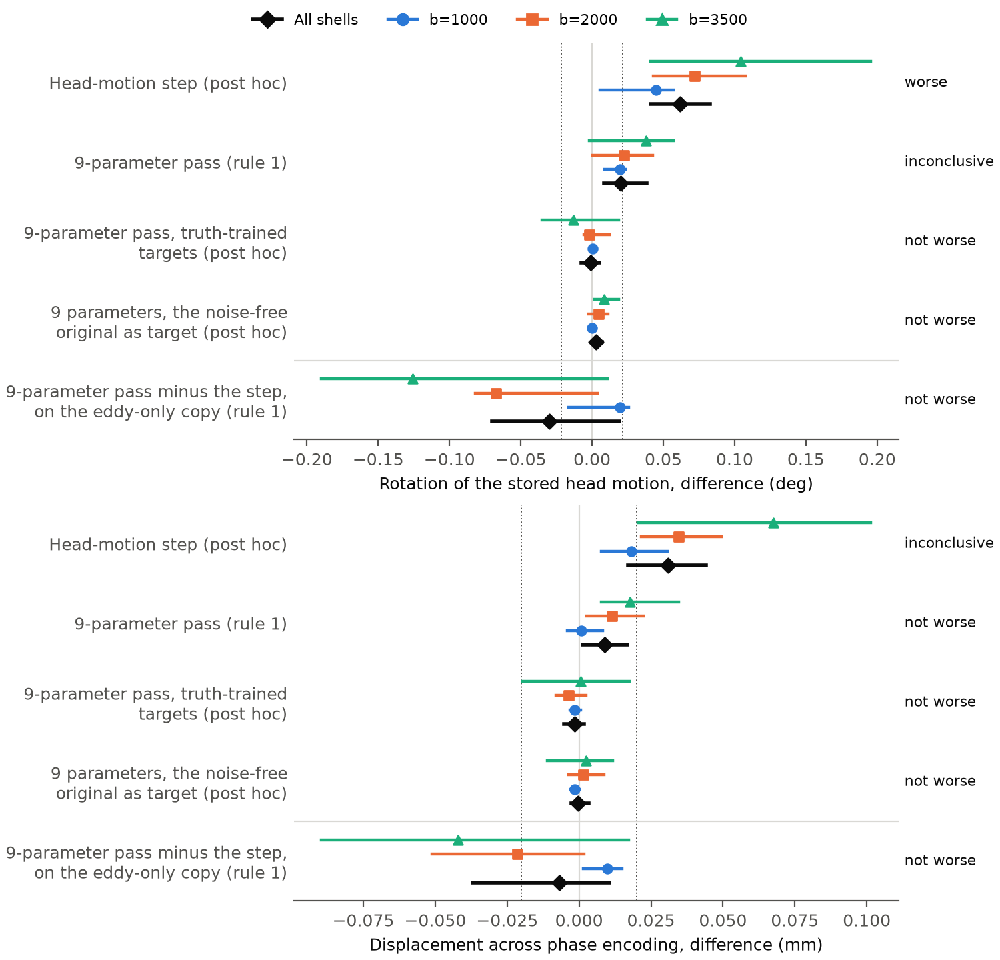
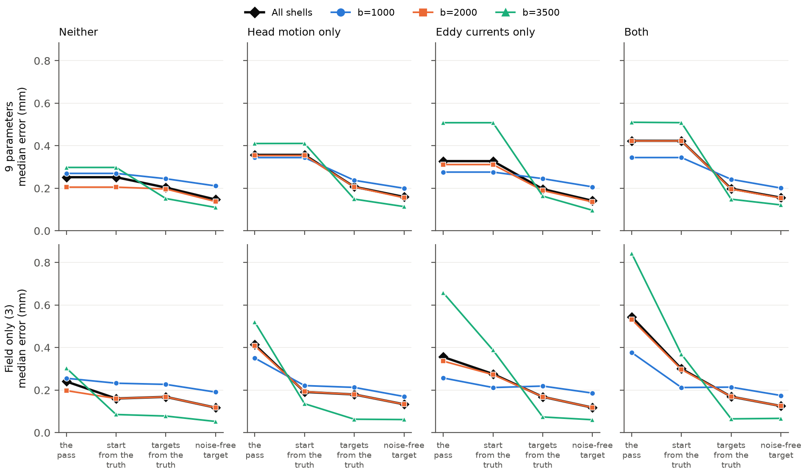

.. include:: ../links.rst

What the eddy-current pass finds
================================
Three tests on `#723 <https://github.com/nipreps/nifreeze/issues/723>`__
(:doc:`eddy-targets`) led to an eddy-current pass that registers each volume with
9 parameters, head motion followed by a field along phase encoding, and the *delayed
update*: the pass's model is trained once, on the data realigned by the head-motion
step, and its estimates are applied after the pass.
Those tests used one copy of the data, with head motion and eddy currents both.
`#735 <https://github.com/nipreps/nifreeze/issues/735>`__ asks whether the pass finds
only what is there, and where the error it leaves comes from.

Test 4: the pass on copies of known parts
-----------------------------------------
Test 4 ran the pass on four copies of the Sherbrooke phantom, each with a known part
missing, under rules posted before the run
(`working hypothesis <https://github.com/nipreps/nifreeze/issues/735#issuecomment-7086226288>`__,
`results <https://github.com/nipreps/nifreeze/issues/735#issuecomment-7088205033>`__).
It asked four questions:

Rule 1, invented head motion
    Does the 9-parameter pass report head motion on data with eddy currents and none?
Rule 2, the field only
    Can 3 parameters, a field along phase encoding with the head motion kept from the
    head-motion step, fit the eddy currents as well as the 9?
Rule 3, invented field
    Does a pass report a field on data with head motion and no eddy currents?
Rule 4, where the rest comes from
    Is the error left by the candidate pass set by where its registrations start, by its
    targets, or by neither?

The registrations
~~~~~~~~~~~~~~~~~
``e12``
    elastix, ``AFFINE``: today's pass.
``i9``
    ITK, the ``itk`` section of :data:`~nifreeze.registration.base.AFFINE` as packaged:
    head motion and a field along phase encoding (:doc:`eddy-targets`, Test 3).
``i3``
    The same, with ``motion: fixed``
    (`#736 <https://github.com/nipreps/nifreeze/issues/736>`__): only the field's 3
    parameters are estimated, about the grid's centre, and the head motion stays the
    start's.
    The phantom's field is zero at the grid's centre, so these 3 parameters are exactly
    its family.

Each registration runs on one thread with seed 12345, and each arm in a process of its
own (`#732 <https://github.com/nipreps/nifreeze/issues/732>`__).

Data and arms
~~~~~~~~~~~~~
The four copies of Sherbrooke come from the phantom dataset (:doc:`../phantoms`):
``unmoved`` (neither head motion nor eddy currents), ``m2s0`` (head motion only),
``e2`` (eddy currents only) and ``m2s0e2`` (both, Test 1's copy).
Their noise is Rician with seed 20261020, keyed on the volume, so each volume carries the
same noise in every copy and pairs with itself across copies.
Phase encoding is along ``j`` (world y).
All 192 volumes are registered; the rules use the 64 confirmation volumes (21, 22 and 21
per shell).
The head-motion step (``gqi-krr`` then ``gp-loo``, rigid, elastix) runs on each copy;
on ``m2s0e2`` it is Test 1's.

On each copy, with ``<r>`` the registration:

``oracle-<r>``
    Each volume registered to its noise-free original, from its true head motion
    (``e12``, ``i9``, ``i3``).
``hm-<r>-hm``
    The delayed pass: targets (``gp-loo``) trained on the copy realigned by the
    head-motion step, and registrations starting from the step's estimates (``e12``,
    ``i9``, ``i3``).
``hm-<r>-truth``
    The same targets, with registrations starting from the truth, moved into the frame
    that the step's estimates share, so that their common offset does not count as an
    error of the start (``i9``, ``i3``).
``truth-<r>-hm``, ``truth-<r>-truth``
    Targets trained on the copy realigned by the truth (on ``unmoved``, the copy as it
    is), starting from the step's estimates or from the truth (``i9``, ``i3``).
    ``truth-<r>-truth`` is the ceiling of better training data.
``pass-e12-u``
    Today's pass, with the *instant update*.

How the results are judged
~~~~~~~~~~~~~~~~~~~~~~~~~~
The *error* is Test 1's: the whole mapping against the truth, in the frame of the arm's
targets (mean displacement within the brain, mm).
The *stored head motion*, which turns the b-vectors, is the split of ``i9``'s estimate;
for ``e12`` and ``i3``, it is the head-motion step's.
It is scored by its rotation against the truth's (degrees) and its displacement across
phase encoding (mean within the brain, mm).
The split of an estimate into head motion and field puts the field's shift along phase
encoding into the head motion, measured at the world's origin, while the phantom's field
is zero at the grid's centre, 17.5 mm from the origin along phase encoding.
So on ``e2`` the truth's own split has head motion, a pure shift along phase encoding
(median 0.21 mm, at most 0.90 mm within the brain), and the shift along phase encoding is
reported but judged by no rule.
The field's error, the volume change and the strain along phase encoding are taken as
in Test 3.

Comparisons are paired by volume (:func:`experiments.paired_comparison`, stratified by
shell, 10,000 resamples).
The margins are 0.01 voxel: 0.02 mm on the error, the field and the displacement across
phase encoding; 0.0215° on the rotation (0.02 mm at the brain's mean radius, 53.36 mm);
and Test 2's 0.0375% on the volume change.
Within a rule, each interval is widened for the rule's number of comparisons
(Bonferroni).

Rule 1
    On ``e2``, ``hm-i9-hm``'s rotation and displacement across phase encoding are
    "better" or "not worse" than its own on ``unmoved``, and than the head-motion
    step's on ``e2`` (4 comparisons).
Rule 2
    ``oracle-i3`` is "better" or "not worse" than ``oracle-i9`` on ``e2``, and
    ``hm-i3-hm`` than ``hm-i9-hm`` on every copy (5 comparisons).
    If it holds, the field-only pass is the candidate; otherwise the 9-parameter pass is.
Rule 3
    On ``m2s0``, the field error of ``hm-i9-hm`` and of ``hm-i3-hm`` is "better" or "not
    worse" than on ``unmoved`` (2 comparisons).
Rule 4
    For the candidate on ``m2s0e2`` (2 comparisons), the start counts if ``hm-<r>-hm`` is
    "worse" than ``hm-<r>-truth``, and the targets count if ``hm-<r>-truth`` is "worse"
    than ``truth-<r>-truth``.
    If the start counts, the next test maps the registration's cost around the truth and
    the estimates; if the targets count, it runs repeated delayed passes, whose best case
    is the ceiling; if neither counts, the error is the floor of the model and the noise.

Results
~~~~~~~
By the rules, the 9-parameter pass stays the candidate, and its error comes from its
targets, not from where it starts: the next test runs repeated delayed passes.

         phase encoding, eddy-only copy minus the copy with neither, per source.

   The stored head motion's error on the eddy-only copy minus the copy with neither,
   paired by volume: the median difference (black, all shells, with its interval) and
   each shell's.
   The last row is the 9-parameter pass minus the head-motion step, both on the eddy-only
   copy.
   The dotted lines are the margins.
   Rows marked *post hoc* are not in the rules (below).

* **Rule 1 fails, on the rotation.**
  On ``e2``, the 9-parameter pass reports 0.020° more rotation than on ``unmoved``
  (+0.020° [+0.008, +0.038], "inconclusive" against the margin of 0.0215°).
  Its displacement across phase encoding is "not worse" (+0.009 mm), and on both scores
  it is "not worse" than the head-motion step's on ``e2`` (−0.030° and −0.007 mm).
  After the results, the extra rotation was traced to the targets (below).
* **Rule 2 fails.**
  Registered to the noise-free originals of ``e2``, the field only is "better" than the 9
  parameters (−0.025 mm [−0.029, −0.019]), and as a pass it is "not worse" on
  ``unmoved`` (−0.012 mm).
  Where there is head motion, it is "worse": +0.054 mm [+0.033, +0.077] on ``m2s0`` and
  +0.073 mm [+0.050, +0.093] on ``m2s0e2``; on ``e2`` it is "inconclusive" (+0.014 mm),
  and "worse" at b=3500 (+0.090 mm).
  It keeps the head-motion step's errors, which the 9 parameters reduce, so the
  9-parameter pass stays the candidate.
* **Rule 3 holds.**
  On ``m2s0``, neither pass reports more field than on ``unmoved``: +0.002 mm with the 9
  parameters and +0.001 mm with the field only.
* **Rule 4: the targets count, the start does not.**
  On ``m2s0e2``, the 9-parameter pass ends at the same place from the head-motion step's
  estimate as from the truth (a median difference of 8e-7 mm).
  Targets trained on the data that the head-motion step corrected add 0.233 mm
  [0.187, 0.304] over targets trained on truth-corrected data, and are "worse" on every
  shell (+0.108, +0.235 and +0.375 mm at b=1000, 2000 and 3500).
  The ceiling, ``truth-i9-truth``, reaches 0.198 mm, against 0.423 mm for the pass.

.. csv-table:: Each comparison of the rules, then those reported: the median difference,
   candidate minus reference, with its interval, overall and by shell.
   :file: ../_static/registration/eddy-pass-parts/eddy-parts-sherbrooke-comparisons.csv
   :header-rows: 1
   :widths: auto

Where the error comes from
~~~~~~~~~~~~~~~~~~~~~~~~~~
This section and the next are reported beside the rules; they decide nothing.

         target's noise are made right in turn.

   Each pass's median error on each copy (black, all shells; colours, each shell), as
   one thing at a time is made right, left to right: the start, the targets' training
   data, and the target's noise (the noise-free original).
   Top, the 9 parameters; bottom, the field only.

* **The 9 parameters do not depend on where they start,** on any copy (median
  differences below 1e-6 mm, intervals within 1e-5 mm).
* **Their targets cost them on every copy with something to correct:**
  +0.164 mm with head motion only, +0.139 mm with eddy currents only and +0.233 mm with
  both.
  On ``unmoved`` the cost is "inconclusive" (+0.027 mm), but "worse" at b=3500
  (+0.131 mm).
  On every copy, b=3500 gains the most from better targets.
* **The field only's start is the head motion it keeps,** and it counts on every copy
  (+0.042 to +0.225 mm).
  With the same targets and the true head motion, its median error is below the
  9-parameter pass's on every copy: 0.300 against 0.423 mm on ``m2s0e2``.
* **What in the targets costs what.**
  With head motion only, targets trained on the step's correction cost the field only
  0.021 mm ("inconclusive"), against 0.164 mm for the 9 parameters: the step's errors
  in the training data pull the head motion that the 9 parameters refine.
  With eddy currents in the data, they cost both (0.139 and 0.122 mm on ``e2``).
* **Better targets alone** (``truth-<r>-hm`` against ``hm-<r>-hm``) help the 9
  parameters by as much as both changes together, since the start does not matter to
  them.

.. csv-table:: Reported: the start and the targets on every copy, better targets alone,
   and each ITK pass against today's, candidate minus reference, with 95% intervals.
   :file: ../_static/registration/eddy-pass-parts/eddy-parts-sherbrooke-reported.csv
   :header-rows: 1
   :widths: auto

Today's pass, the floor and the volume change
~~~~~~~~~~~~~~~~~~~~~~~~~~~~~~~~~~~~~~~~~~~~~
* **The instant update hurts at b=1000 on every copy,** by 0.149 to 0.218 mm against
  elastix's delayed pass, on ``unmoved`` too: its harm there needs neither head motion
  nor eddy currents.
  At b=3500 it is "better" on ``e2`` (−0.040 mm) and "not worse" on the others.
* **The 9-parameter pass beats today's on every copy,** by 0.063 to 0.129 mm, and at
  b=1000 and b=2000; at b=3500 it is "worse" on ``unmoved`` (+0.063 mm) and
  "inconclusive" on the others.
* **The floor.**
  On ``unmoved``, with nothing to correct, the passes leave 0.231 (elastix), 0.252 (9
  parameters) and 0.240 mm (field only); registered to the noise-free originals,
  0.152, 0.147 and 0.117 mm.
* **The volume change** of the ITK passes is +0.14 to +0.18%; elastix's delayed pass,
  +0.36 to +0.51%; today's, +0.52 to +0.75%.
* **Time:** 2.3 to 2.4 s per registration, with any of the three registrations.

.. csv-table:: Each arm's medians on the confirmation volumes: the error, overall and by
   shell; the stored head motion's rotation and displacements across and along phase
   encoding; the field's error; the volume change and the strain along phase encoding;
   and the time per registration.
   :file: ../_static/registration/eddy-pass-parts/eddy-parts-sherbrooke-arms.csv
   :header-rows: 1
   :widths: auto

.. csv-table:: The head-motion step's errors on each copy (medians, in the frame of the
   targets).
   :file: ../_static/registration/eddy-pass-parts/eddy-parts-sherbrooke-cascade.csv
   :header-rows: 1
   :widths: auto

After the results: where the extra rotation comes from
~~~~~~~~~~~~~~~~~~~~~~~~~~~~~~~~~~~~~~~~~~~~~~~~~~~~~~
An analysis after the results, not in the rules (*post hoc*), compared ``e2`` with
``unmoved`` for three more sources of head motion, with intervals widened for its 6
comparisons (the rows marked *post hoc* in the figure and the table above):

* **The head-motion step** reports 0.062° more rotation on ``e2`` (+0.062°
  [+0.041, +0.083], "worse"), and 0.031 mm more across phase encoding ("inconclusive").
* **The 9 parameters with truth-trained targets** report none (−0.001° and −0.002 mm,
  "not worse"), nor **registered to the noise-free originals** (+0.003° and −0.000 mm).

So the 9 parameters keep head motion and the field apart; with the realistic targets
they report a third of the rotation that the step adds.
The extra rotation comes in through the targets, trained on data that the step left
with its eddy currents and corrected with the rotation it reports; this analysis does not
separate the two.

Checks
~~~~~~
* The truth is exact, to 6e-14 mm.
* The field-only estimates are the given head motion followed by a field along phase
  encoding, to 3e-13 mm.
* On ``m2s0e2``, the head-motion step is Test 1's bit for bit; the delayed passes
  reproduce Test 3's to 7.5e-14 mm, and today's pass and the registration to the
  noise-free originals bit for bit.
* No registration failed.

Consequences
~~~~~~~~~~~~
* The 9-parameter pass stays the candidate for the eddy-current pass.
  The field-only setting (`#737 <https://github.com/nipreps/nifreeze/pull/737>`__) would
  be the best pass with the true head motion, but it keeps the head-motion step's errors.
* Its error comes from the data its targets are trained on, not from where its
  registrations start, so a local minimum of the cost near the estimates does not explain
  it.
  The next test runs repeated delayed passes, each training on the data the last one
  corrected; their best case is the ceiling, 0.198 mm on ``m2s0e2`` against 0.423 mm for
  one pass.
* The head-motion step reports rotation when there are eddy currents, and the
  9-parameter pass reduces the step's rotation error where there is head motion
  (medians: 0.299° to 0.247° on ``m2s0``, 0.359° to 0.263° on ``m2s0e2``) but not on
  ``unmoved`` (0.135° to 0.149°).
* The instant update's harm at b=1000 does not come from correcting head motion or eddy
  currents: it is there on data with neither.

Limits
~~~~~~
* The phantom's field turns about the grid's centre, with no shift along phase encoding.
  Real eddy currents can shift the image along phase encoding, which the field-only
  pass's 3 parameters cannot fit.
* One protocol, Sherbrooke; HCP-YA's b=3000 gap (:doc:`eddy-targets`) is not tested here.

Reproducing
~~~~~~~~~~~
The run was made outside the phantom dataset, without a ``datalad run`` record, with the
dataset at commit 826e611 at the start and the end, itk-elastix 0.25.4, and
oesteban/nifreeze@10ecfe219 (clean), on CPUs 0-5; it took 2 h 27 min.
The rules' code is unchanged since 10ecfe219; the post hoc analysis, the tables and the
figures come from later commits of ``eddy_pass_parts_figures.py``.
The head-motion step on ``m2s0e2`` and the checks against Test 3 read Test 1's and
Test 3's results.
From the repository's root::

    OMP_NUM_THREADS=6 uv run tools/registration/eddy_pass_parts.py --dataset <dataset> \
        --out <results> --test1 <Test 1's results>/sherbrooke.npz \
        --test3 <Test 3's results>/arms --jobs 6 --threads 6
    uv run tools/registration/eddy_pass_parts_figures.py --results <results> \
        --out docs/_static/registration/eddy-pass-parts
