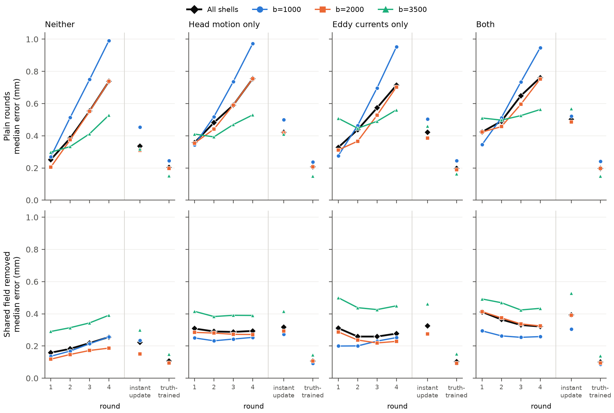
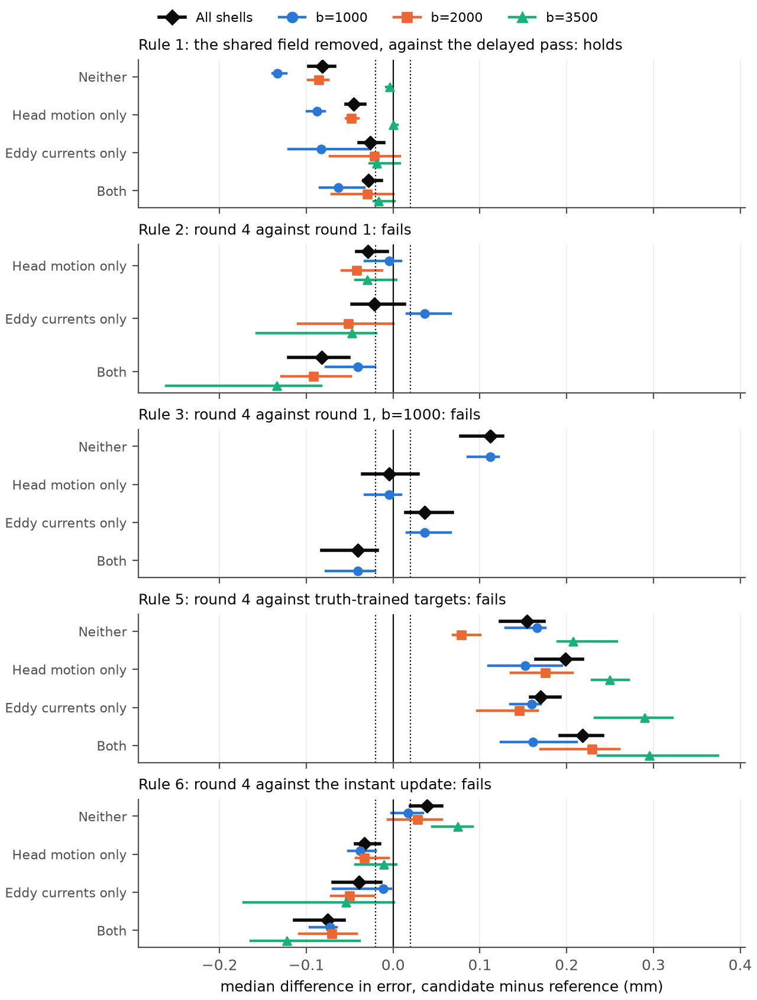

.. include:: ../links.rst

Repeating the delayed eddy-current pass
=======================================
Test 4 (:doc:`eddy-pass-parts`) found that the 9-parameter eddy-current pass loses most
of its accuracy to its targets: trained on the data that the head-motion step corrected,
they cost it 0.233 mm on the copy with head motion and eddy currents, while where its
registrations start costs nothing.
Test 5 on `#735 <https://github.com/nipreps/nifreeze/issues/735>`__ asks whether
repeating the delayed update, each round training its targets on the data that the last
round corrected, brings the pass down to the error it has with targets trained on the
truth, without the instant update's harm at b=1000
(`working hypothesis <https://github.com/nipreps/nifreeze/issues/735#issuecomment-7094190809>`__,
`results <https://github.com/nipreps/nifreeze/issues/735#issuecomment-7097494480>`__).

The shared field
----------------
A pilot of the second round, on the development volumes, was worse than the first.
Every volume of a shell shares a stretch along phase encoding that the registration adds
(in the pilot's round 1, on the development volumes: +0.73% at b=1000, +0.50% at b=2000
and +0.06% at b=3500).
Retraining on the data corrected by those estimates bakes the stretch into the targets,
and the next registration adds it again.

Eddy currents follow the diffusion gradient, so a field that every volume of a shell
shares is not eddy currents.
:func:`~nifreeze.registration.utils.remove_shared_field`
(`#738 <https://github.com/nipreps/nifreeze/issues/738>`__,
`#739 <https://github.com/nipreps/nifreeze/pull/739>`__) removes it, shell by shell: the
intercept of the field's slopes regressed on the b-vector, applied about the brain's
centroid, with the head motion and the field split again afterwards.
The test therefore runs two kinds of rounds, and its rules judge the rounds that remove
the shared field.

Data and arms
-------------
The data are Test 4's four copies of Sherbrooke: ``unmoved`` (neither head motion nor
eddy currents), ``m2s0`` (head motion only), ``e2`` (eddy currents only) and ``m2s0e2``
(both), with the same noise in every copy.
All 192 volumes are registered; the rules use the 64 confirmation volumes.
Every registration run here is the 9-parameter ITK registration of Test 4, on one thread;
today's pass is read from Test 4.

``removed<k>-i9``, ``k`` = 1 to 4
    The rounds that remove the shared field.
    Round 1 is Test 4's delayed pass (``hm-i9-hm``) with the shared field removed.
    Round ``k`` trains its targets (``gp-loo``, each volume left out) on the copy
    realigned by round ``k - 1``'s estimates, head motion and field as the pass stores
    them, with the head motion turning the b-vectors; registers every volume against
    them, in parallel, starting from its round ``k - 1`` estimate; and removes the
    shared field from the result.
``round<k>-i9``
    The plain rounds: the same, without the removal.
    Round 1 is Test 4's delayed pass.
``pass-i9-u``, ``pass-i9-u-removed``
    The 9-parameter pass with the instant update, from the head-motion step, as it is
    and with the shared field removed from its estimates.
``truth-i9-truth``, ``truth-i9-truth-removed``
    Test 4's ceiling, targets trained on the copy realigned by the truth and registrations
    starting from the truth, as it is and with the shared field removed.
``pass-e12-u``
    Today's pass: elastix, 12 parameters, the instant update (Test 4's).

How the results are judged
--------------------------
The error is Test 4's: the whole mapping against the truth, in the frame of the arm's
targets (mean displacement within the brain, mm).
Round ``k``'s frame, for ``k`` of 2 or more, is the transform that all of round
``k - 1``'s estimates share against the truth; round 1's is the head-motion step's, as in
Test 4.
A change of size that every volume shares counts as error, as in Tests 1 to 4.
The stored head motion is scored by its rotation (degrees) and its displacement across
phase encoding (mm).
Comparisons are paired by volume (:func:`experiments.paired_comparison`, stratified by
shell, 10,000 resamples), with Test 4's margins: 0.02 mm and 0.0215°.
Within a rule, the interval over all shells is widened for the rule's comparisons
(Bonferroni: 98.75% for rules 1, 3, 5 and 6, 98.33% for rule 2, 97.5% for rule 4); the
intervals by shell, and those reported beside the rules, are 95%.

Rule 1, the removal
    Round 1 with the shared field removed is "better" or "not worse" than Test 4's
    delayed pass on every copy.
Rule 2, the rounds help
    Round 4 is "better" than round 1 on ``m2s0``, ``e2`` and ``m2s0e2``.
Rule 3, no harm at b=1000
    At b=1000, round 4 is "better" or "not worse" than round 1 on every copy.
Rule 4, no invented head motion
    On ``e2``, round 4's stored head motion is "better" or "not worse" than on
    ``unmoved``, in rotation and across phase encoding.
Rule 5, the ceiling
    Round 4 is "better" or "not worse" than ``truth-i9-truth-removed`` on every copy.
Rule 6, the instant update
    Round 4 is "better" or "not worse" than ``pass-i9-u-removed`` on every copy.

Results
-------
By the rules, the eddy-current pass gets the removal, and round 4 invents no head
motion; the rounds do not hold, so the pass stays at one delayed pass.

         remove the shared field, with the instant update and the truth-trained targets.

   Each copy's median error by round (black, all shells; colours, each shell), on the
   confirmation volumes: the plain rounds on top, the rounds that remove the shared field
   below.
   To the right of each panel, the instant update and the truth-trained targets, with the
   same treatment.

         copy.

   Each rule's paired differences in error, candidate minus reference: the median
   difference over all shells (black, with the rule's widened interval) and each shell's
   (95%).
   Left of zero is better; the dotted lines are the margins.

* **Rule 1 holds.**
  Removing the shared field lowers the delayed pass's error on every copy, by 0.026 to
  0.082 mm, most at b=1000 (0.063 to 0.133 mm).
  The volume change goes from +0.15 to +0.18% to between −0.032 and +0.014%.
* **Rule 2 fails.**
  Round 4 is "better" than round 1 on ``m2s0`` (−0.029 mm) and ``m2s0e2``
  (−0.083 mm), and only "not worse" on ``e2`` (−0.022 mm [−0.048, +0.013]).
* **Rule 3 fails.**
  At b=1000, round 4 is "worse" than round 1 on ``unmoved`` (+0.112 mm), "inconclusive"
  on ``m2s0`` (−0.004 mm) and ``e2`` (+0.037 mm), and "better" on ``m2s0e2``.
* **Rule 4 holds.**
  On ``e2``, round 4's stored head motion is "not worse" than on ``unmoved``: −0.004° in
  rotation and −0.007 mm across phase encoding.
  This settles Test 4's rule 1 for round 4 only.
  One delayed pass with the shared field removed stores the same rotation as Test 4's
  delayed pass, since the removal changes only the head motion's shift along phase
  encoding; for that pass, Test 4's rule 1 stays "inconclusive" (+0.020°).
  Round 4 passes partly because the rotation error on ``unmoved`` grew faster over the
  rounds (0.149° to 0.260°) than on ``e2`` (0.180° to 0.247°).
* **Rule 5 fails.**
  Round 4 stays 0.154 to 0.218 mm above the truth-trained targets on every copy.
  On ``m2s0e2``, rounds 2 to 4 recover 0.09 of the 0.31 mm between round 1 and the
  ceiling (medians).
* **Rule 6 fails on** ``unmoved``, where round 4 against the instant update is
  "inconclusive" (+0.039 mm [+0.020, +0.056], the lower bound 0.0196 mm, just under the
  margin) and "worse" at b=3500 (+0.074 mm).
  Round 4 is "better" than the instant update on the other three copies, by 0.033 to
  0.076 mm.

.. csv-table:: Each comparison of the rules: the median difference, candidate minus
   reference, with its interval over all shells (widened within each rule), and each
   shell's median and 95% verdict.
   :file: ../_static/registration/eddy-pass-rounds/eddy-rounds-sherbrooke-comparisons.csv
   :header-rows: 1
   :widths: auto

Reported beside the rules
-------------------------
* **The rounds with the shared field removed settle by round 3,** the last that is
  "better" than the one before on some copy (``m2s0e2``, −0.024 mm).
  On ``unmoved`` every round is "worse" than the one before, by 0.024 to 0.029 mm.
* **The plain rounds compound the stretch.**
  Each is "worse" than the one before on every copy (+0.090 to +0.186 mm), except round
  2 on ``m2s0e2`` (+0.060 mm, "inconclusive"); round 4 is worse than round 1 by 0.339 to
  0.533 mm, and the volume change reaches +0.64 to +0.68%.
* **Against today's pass,** round 4 with the shared field removed is "better" on every
  copy, by 0.098 to 0.281 mm, but "worse" at b=3500 on ``unmoved`` (+0.150 mm).
  The 9-parameter instant update is "inconclusive" on ``unmoved`` (+0.029 mm) and
  "better" on the others; Test 4's delayed pass is "better" on every copy (0.063 to
  0.129 mm), but "worse" at b=3500 on ``unmoved`` (+0.063 mm).
* **Round 4 is "better" than the instant update as it is** on every copy, by 0.094 to
  0.165 mm, but "worse" at b=3500 on ``unmoved`` (+0.047 mm).
* **The frame drifts.**
  Each round's frame, against round 1's, turns by 0.04 to 0.07° a round with the shared
  field removed, to 0.11 to 0.18° by round 4; in the plain rounds, to 0.04 to 0.13°.
  Each round is scored in its own frame, so the drift does not count as error.
* **Time:** 2 h 27 min on CPUs 0-5.
  Each round on 192 volumes takes 84 to 129 s for the targets and 84 to 88 s for the
  registrations; each instant pass, 578 to 606 s.

.. csv-table:: Reported: each round against the one before, the plain rounds' round 4
   against round 1, three passes against today's, and round 4 against the instant update
   as it is; candidate minus reference, with 95% intervals.
   :file: ../_static/registration/eddy-pass-rounds/eddy-rounds-sherbrooke-reported.csv
   :header-rows: 1
   :widths: auto

.. csv-table:: Each arm's medians on the confirmation volumes: the error, overall and by
   shell; the stored head motion's rotation and displacement across phase encoding; the
   field's error; the volume change and the strain along phase encoding; and the time per
   registration.
   :file: ../_static/registration/eddy-pass-rounds/eddy-rounds-sherbrooke-arms.csv
   :header-rows: 1
   :widths: auto

After the results: what the rounds feed forward
-----------------------------------------------
The analyses in this section came after the results (*post hoc*); they decide nothing,
and their intervals are 95%.

* **Both updates feed the shared stretch forward.**
  It comes from the registration: the truth-trained targets have it too (+0.17 to
  +0.18%).
  The plain rounds add it again each round, and the instant update builds it up within
  one pass (+0.27 to +0.28%).
  Removing the shared field helps the instant update more than the delayed one: by 0.063
  to 0.135 mm, and by 0.21 to 0.26 mm at b=1000.
* **The removal takes 44 to 73% of the instant update's harm at b=1000.**
  Against the delayed update, the instant update is "worse" at b=1000 by 0.093 to
  0.164 mm as they are, and by 0.025 to 0.092 mm with the shared field removed from both
  ("worse" on ``unmoved`` and ``e2``, "inconclusive" on the others).
  What is left is not traced.
* **The pass's errors follow the axis of the b-vector.**
  Within each shell, a quadratic fit on the b-vector's direction, the same for ``g``
  and ``-g`` as the diffusion signal is, explains 51 to 92% of the variance of the
  stored head motion's rotation error, in every round, kind and copy; a linear fit
  explains 2 to 12%.
  By chance alone they would explain about 8% and 5% (5 and 3 free terms over 63
  degrees of freedom; on unit b-vectors, the three squares sum to 1).
  The field's error goes the same way: on ``e2``, its quadratic share grows from about
  half in round 1 to 87 to 89% in round 4, while the share that follows the gradient
  linearly, as eddy currents do, falls.
  With nothing to correct, on ``unmoved``, the error grows by about 0.03 mm a round, and
  part of it is a rotation that the b=1000 volumes share: 0.15° in round 1, 0.27° in
  round 4.
  This analysis shows how the errors follow the b-vector; it does not test why, nor
  whether retraining on them is what makes them grow.
* **One delayed pass with the shared field removed is the pass to carry forward.**
  It is "better" than today's pass on every copy, by 0.094 to 0.187 mm; at b=3500 it is
  "worse" on ``unmoved`` (+0.057 mm) and "inconclusive" on the others.
  Against the instant update with the shared field removed, it is "better" on
  ``unmoved`` (−0.035 mm), "not worse" on ``m2s0`` and ``e2``, and "inconclusive" on
  ``m2s0e2`` (+0.000 mm [−0.009, +0.020], the upper bound at the margin).
  The two trade shells: at b=1000 the delayed update is "better" on three copies, by
  0.025 to 0.092 mm, and "not worse" on ``m2s0``; at b=3500 it is "inconclusive" on three
  copies (+0.003 to +0.044 mm), and on ``m2s0e2`` the instant update is "better" there
  (−0.034 mm).
  It registers every volume at once: a round takes 2.8 to 3.6 min on 6 CPUs with its
  targets (rounds 2 to 4), against about 10 min for the instant update.

.. csv-table:: Post hoc: round 1 with the shared field removed against today's pass and
   against the instant update; the instant update against the delayed one, as they are
   and with the shared field removed; the removal on the instant update; and rounds 3 and
   4 against round 1. Candidate minus reference, with 95% intervals.
   :file: ../_static/registration/eddy-pass-rounds/eddy-rounds-sherbrooke-posthoc.csv
   :header-rows: 1
   :widths: auto

.. list-table:: How the errors follow the b-vector, in the rounds that remove the shared
   field (all 192 volumes): per shell, the rotation error of the stored head motion (RMS),
   the rotation the shell shares, and the share of the rest's variance that a linear or a
   quadratic fit on the b-vector explains; then the same shares for the field's slopes.
   Every round, kind and copy is in
   :download:`eddy-rounds-sherbrooke-shares.csv <../_static/registration/eddy-pass-rounds/eddy-rounds-sherbrooke-shares.csv>`.
   :header-rows: 1

   * - Copy
     - Round
     - Shell
     - Rotation (RMS)
     - Shared
     - Linear
     - Quadratic
     - Field: linear
     - Field: quadratic
   * - ``unmoved``
     - 1
     - 1000
     - 0.184°
     - 0.151°
     - 6%
     - 71%
     - 6%
     - 4%
   * - ``unmoved``
     - 1
     - 3500
     - 0.336°
     - 0.043°
     - 9%
     - 84%
     - 6%
     - 39%
   * - ``unmoved``
     - 4
     - 1000
     - 0.277°
     - 0.266°
     - 3%
     - 53%
     - 6%
     - 36%
   * - ``unmoved``
     - 4
     - 3500
     - 0.383°
     - 0.126°
     - 9%
     - 88%
     - 9%
     - 78%
   * - ``e2``
     - 1
     - 2000
     - 0.151°
     - 0.033°
     - 11%
     - 58%
     - 48%
     - 49%
   * - ``e2``
     - 4
     - 2000
     - 0.207°
     - 0.022°
     - 10%
     - 85%
     - 18%
     - 89%

Checks
------
* The 9-parameter instant pass on ``m2s0e2`` reproduces Test 3's bit for bit.
* **The working hypothesis required the Estimator's round 2 to match the round's within
  1e-6 mm; it misses.**
  Run by the :class:`~nifreeze.estimator.Estimator` with the delayed update from round
  1's stored estimates, the plain round 2 on ``m2s0e2`` differs from the round's by up to
  0.012 mm, though their medians agree (0.490 mm each).
  The targets are identical.
  The Estimator starts each registration from the stored split put back together, which
  differs from the stored estimate by up to 7e-16; registering the three volumes that
  differ most again, from each start, reproduces each run to 2.3e-16.
  So the gap is rounding in the start, which the 9-parameter registration carries to up
  to 0.012 mm, and not a difference in the update.
* No registration failed.

Consequences
------------
Each posted consequence, rule by rule:

* **Rule 1 holds:** the eddy-current pass gets the removal of the shared field
  (`#738 <https://github.com/nipreps/nifreeze/issues/738>`__).
* **Rule 2 fails:** retraining on the pass's own estimates does not recover what its
  targets cost, even without the stretch.
  The posted next step, a test that starts from where the rounds stop, is set aside:
  the rounds are not taken (rules 3 and 6), so the next test starts from one delayed
  pass.
* **Rule 3 fails.**
  Its posted next step, rounds above b=2000 only, is set aside: on ``unmoved``, round 4
  is also "worse" than round 1 at b=2000 (+0.066 mm) and b=3500 (+0.080 mm) (post hoc).
* **Rule 4 holds for round 4.**
  For one delayed pass, Test 4's rule 1 stays "inconclusive".
* **Rule 5 fails:** the gap to the truth-trained targets is what the pass's own errors
  leave in its targets.
* **Rule 6 fails on** ``unmoved``.
  Its posted next step compares the delayed and the instant update by shell; post hoc,
  that comparison for one delayed pass (above) shows them trading b=1000 for b=3500.
  Whether the highest shell should take the instant update stays open.

So the delayed pass with the shared field removed is the pass to carry forward (post
hoc), and HCP-YA's confirmation compares it with today's pass.
The pass's remaining errors follow the axis of the b-vector, the same for ``g`` and
``-g``; eddy currents change sign with the gradient, so a field made to follow the
gradient linearly could not carry that part, which is not tested here.

Limits
------
* Across shells, the b-value, the signal-to-noise ratio and the field's size change
  together; the shell effects here do not separate them.
* The phantom's field has no shift along phase encoding of its own; real eddy currents
  can.
* One protocol, Sherbrooke.
* Which pass to carry forward is decided after the results, from comparisons that the
  rules did not make.

Reproducing
-----------
The run was made outside the phantom dataset, without a ``datalad run`` record, with the
dataset at commit 826e611 at the start and the end, itk-elastix 0.25.4, and
oesteban/nifreeze@0180371b1 (clean), on CPUs 0-5; it started four seconds after the
working hypothesis was posted, and took 2 h 27 min.
It reads Test 4's results (round 1, the head-motion step, the truth-trained targets and
today's pass) and Test 3's instant pass, for the check.
The rules' code is unchanged since 0180371b1; the post hoc comparisons, the split of the
errors and the figures' layout come from later versions.
From the repository's root::

    OMP_NUM_THREADS=6 uv run tools/registration/eddy_pass_rounds.py --dataset <dataset> \
        --out <results> --test4 <Test 4's results>/arms \
        --test3 <Test 3's results>/arms --jobs 6 --threads 6
    uv run tools/registration/eddy_pass_rounds_figures.py --results <results> \
        --out docs/_static/registration/eddy-pass-rounds
    uv run tools/registration/eddy_pass_rounds_shares.py --dataset <dataset> \
        --results <results> --test4 <Test 4's results>/arms \
        --out docs/_static/registration/eddy-pass-rounds
